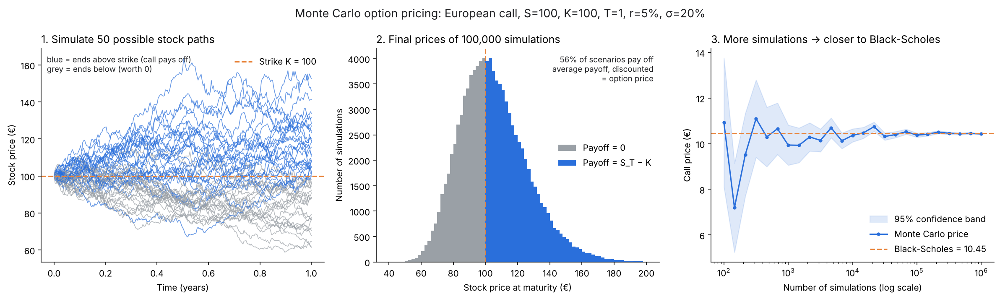

# Options Pricer

Options pricing simulator in Python, built step by step.

## Features

- [x] Black-Scholes pricing for European calls and puts
- [x] Greeks: delta, gamma, vega, theta, rho
- [x] Monte Carlo pricer with convergence check
- [ ] Binomial tree (American options)
- [ ] Implied volatility and volatility smile on live market data
- [ ] Interactive Streamlit app

## Run it

```bash
pip install -r requirements.txt
python black_scholes.py
python monte_carlo.py
python visualize_mc.py   # creates monte_carlo.png
```

Example output (S=100, K=100, T=1, r=5%, sigma=20%):

```
Call price: 10.4506
Put price:  5.5735
Put-call parity gap (should be ~0): 0.00e+00
```

## The model

Black-Scholes prices a European call as

C = S·N(d1) − K·e^(−rT)·N(d2)

with d1 = [ln(S/K) + (r + σ²/2)T] / (σ√T) and d2 = d1 − σ√T.
The put follows from put-call parity: C − P = S − K·e^(−rT).

## Monte Carlo convergence



Monte Carlo simulates stock prices at maturity, averages the discounted payoffs and converges to the Black-Scholes price as the number of simulations grows (error shrinks with 1/sqrt(n)):

| Simulations | MC price | Std error | Error vs BS |
|---:|---:|---:|---:|
| 100 | 7.8258 | 1.0120 | -2.6248 |
| 1,000 | 9.9120 | 0.4483 | -0.5386 |
| 10,000 | 10.3452 | 0.1477 | -0.1054 |
| 100,000 | 10.4205 | 0.0468 | -0.0300 |
| 1,000,000 | 10.4532 | 0.0147 | 0.0026 |
